# Pandora Engine

**카툰만 그리는, 스스로 설명하는 DirectX 12 엔진**

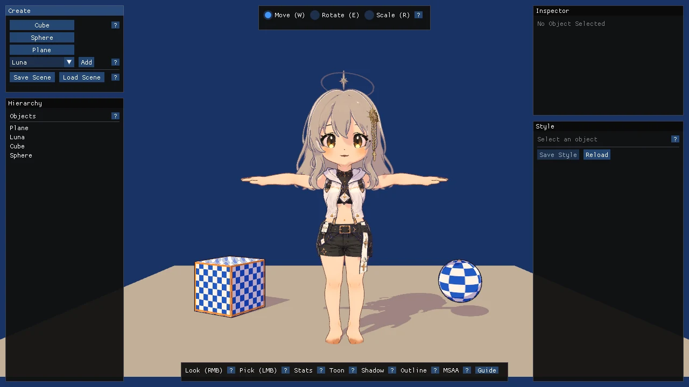

C++와 DirectX 12로 만든 카툰 전용 엔진입니다. 판도라 IP 게임(Pandora Arena, Pandora Battle)의 캐릭터를 게임과 같은 그림체로 그리는 것이 목표입니다. 그래서 사실적인 조명 대신 2단 명암, 외곽선, 그림자처럼 카툰에 필요한 것만 담습니다.

에디터의 물음표(`?`)를 누르면 그 기능이 어떤 클래스를 거쳐 움직이는지 엔진 안의 카드 도감으로 보여 줍니다. 도감과 카툰 렌더링 코드는 Claude Code와 함께 작성하고 있습니다.

[단계별로 만든 것](#단계별로-만든-것) · [카툰 화면](#카툰-화면을-그리는-방법) · [도감](#물음표에서-클래스-카드까지) · [코드 구조](#코드-구조) · [빌드와 실행](#빌드와-실행) · [포트폴리오 페이지](https://hyeonsik-game-portfolio.vercel.app/projects/directx12-engine/)

## 한눈에 보기

| 항목 | 내용 |
|---|---|
| 언어와 API | C++17, DirectX 12, HLSL(실행할 때 `D3DCompileFromFile`로 컴파일) |
| 한 프레임 | 그림자 맵 → 2단 명암 → 외곽선 → MSAA 4배 평균 → 에디터 |
| 에디터 | Dear ImGui와 ImGuizmo로 만든 물체 만들기 · 고르기 · 옮기기, 장면 저장, 재질별 Style 패널 |
| 모델 | glTF 2.0을 직접 만든 리더로 읽고, 텍스처는 WIC로 읽습니다 |
| 도감 | 카드 95장(클래스 84개), 기능 설명 16개, 단계 6개(커밋 66개) |
| 비교 | 같은 장면을 Pandora Arena 셰이더(Unity URP)로 그린 그림과 색 차이 중앙값 1\~4(0\~255) |

## 단계별로 만든 것

계획을 단계로 나눠 만들고, 단계마다 같은 카메라로 화면을 찍어 둡니다. 단계를 마칠 때마다 커밋과 그때 생긴 클래스를 도감에 적습니다.

<table>
<tr>
<td width="33%" valign="top">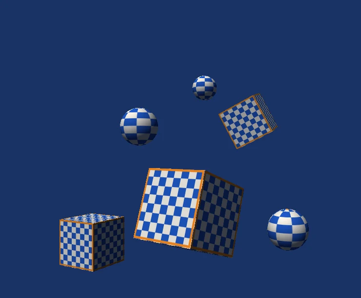<br><b>0단계 · 엔진의 뼈대</b><br><sub>2026.08 – 11.23 · 커밋 25개</sub><br>삼각형 하나에서 시작해 물체를 놓고 고르고 옮기고 저장하는 편집기와 엔진 안 도감</td>
<td width="33%" valign="top">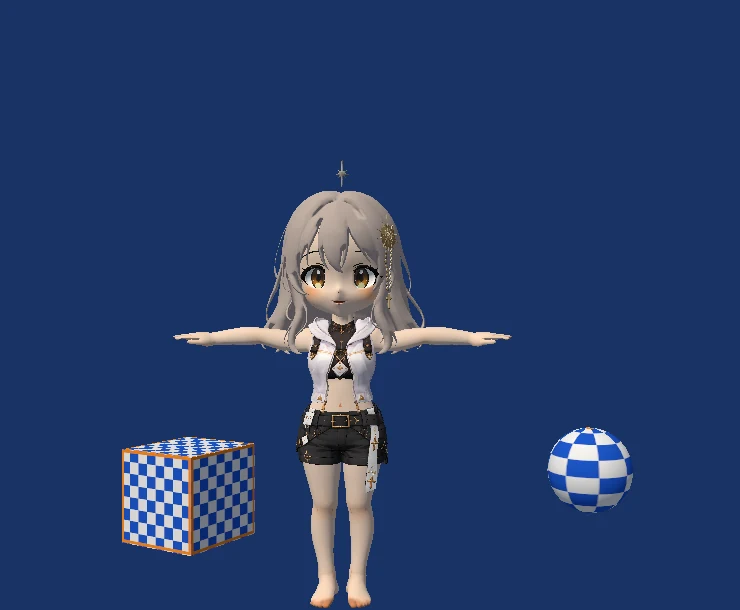<br><b>1단계 · Luna 띄우기</b><br><sub>2026.11.23 · 커밋 10개</sub><br>glTF 모델을 읽어 재질마다 자기 텍스처를 입히고 Luna를 T자세로 띄움</td>
<td width="33%" valign="top">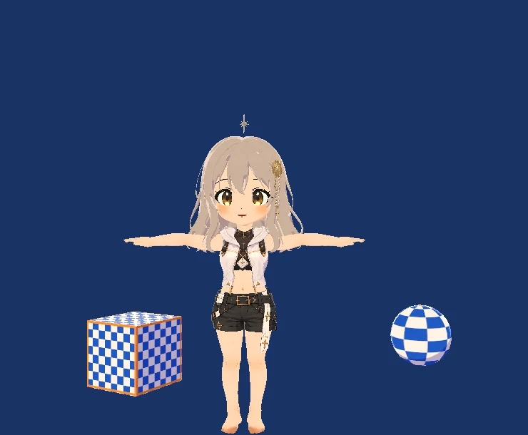<br><b>2단계 · 2단 명암</b><br><sub>2026.11.23 · 커밋 8개</sub><br>밝은 면과 그늘을 두 단으로 끊고, 재질마다 다른 그늘색과 림라이트</td>
</tr>
<tr>
<td width="33%" valign="top">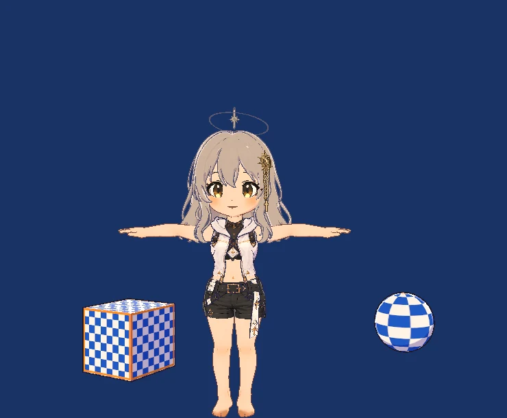<br><b>3단계 · 외곽선</b><br><sub>2026.11.23 – 11.24 · 커밋 6개</sub><br>뒷면을 부풀려 거리와 해상도가 달라도 같은 굵기로 보이는 외곽선</td>
<td width="33%" valign="top">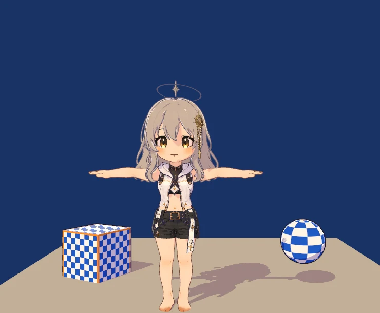<br><b>4단계 · 그림자</b><br><sub>2026.11.24 – 11.25 · 커밋 10개</sub><br>그림자도 같은 두 단으로 끊고, MSAA 4배로 윤곽의 계단을 없앰</td>
<td width="33%" valign="top">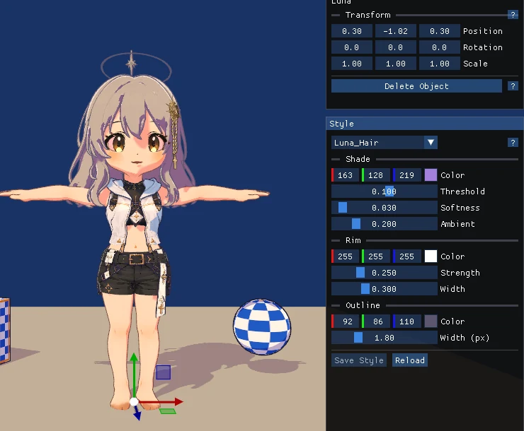<br><b>5단계 · 스타일 저장</b><br><sub>2026.11.25 · 커밋 7개</sub><br>재질마다 그림체 값을 고쳐 저장하는 Style 패널과 Unity로 옮기는 스크립트</td>
</tr>
</table>

## 카툰 화면을 그리는 방법

### 한 프레임의 순서

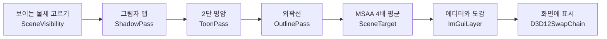

`D3D12Context::RenderFrame`이 한 프레임을 이 순서로 기록합니다. 그림자 패스는 화면 밖에 있어도 빛의 시야에 든 물체를 그리고, 화면 패스는 카메라에 보이는 물체만 그립니다. 물체를 먼저 그려 두기 때문에 안쪽에 가려진 외곽선은 깊이 비교에서 지워집니다.

### 2단 명암과 림라이트

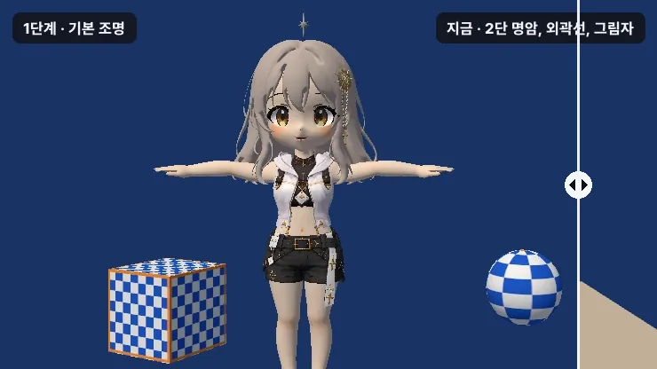

<sub>같은 카메라와 같은 자리에서 찍은 1단계와 지금 화면입니다.</sub>

빛을 받는 정도(N·L)를 `smoothstep`으로 한 번 끊어 밝은 면과 그늘 두 단으로 나눕니다. 그늘은 검게 누르지 않고 재질마다 정한 색을 곱하고, 시선과 거의 직각인 가장자리에는 밝은 테두리(림라이트)를 더합니다. 식과 값은 Pandora Arena의 `Toon.shader`에서 옮겼습니다.

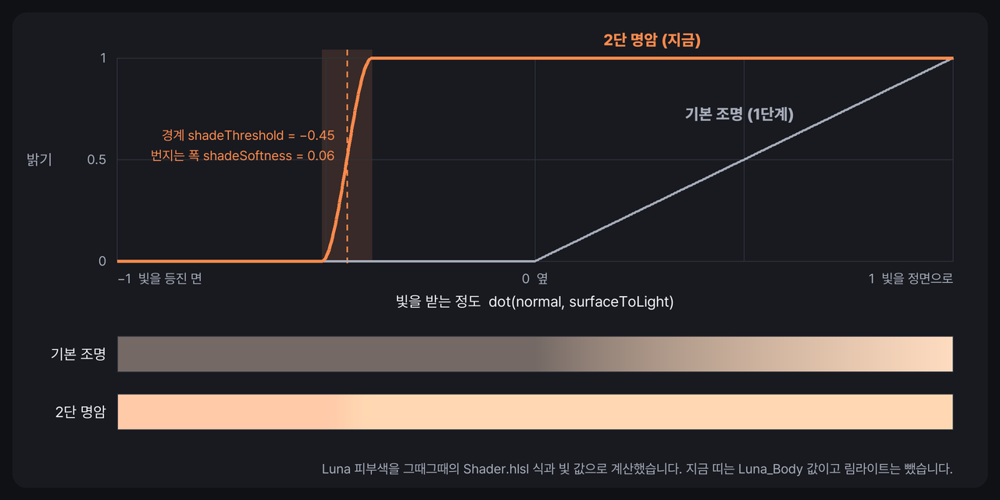

```hlsl
// Shader.hlsl의 PSMain 일부
const float facing = smoothstep(
    shadeThreshold - shadeSoftness,
    shadeThreshold + shadeSoftness,
    dot(normal, surfaceToLight));
const float lit = facing * SampleShadow(input.worldPosition);
float3 color = baseColor.rgb * lerp(shadeColor, 1.0f, lit) * lightColor.rgb * lightColor.w;
```

### 외곽선

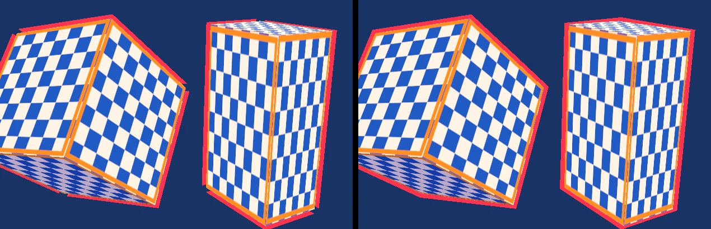

<sub>왼쪽: 원래 법선으로 밀면 모서리에서 선이 갈라집니다. 오른쪽: 구운 법선으로 밀면 이어집니다.</sub>

물체를 그린 뒤 앞면을 버리고 뒷면을 화면에서 정해진 픽셀만큼 바깥으로 밀어 한 번 더 그립니다(`OutlinePass`). 그래서 거리와 해상도가 달라도 선의 굵기가 같습니다. 각진 모서리에서는 정점마다 법선이 달라 선이 갈라지므로, 모델을 GPU에 올리기 전에 같은 자리 정점의 법선을 평균해 구워 둡니다(`OutlineNormalBaker`).

### 그림자

빛에서 본 깊이를 2048×2048 그림자 맵에 그립니다(`ShadowPass`). 명암을 계산할 때 두 칸씩 떨어진 열여섯 자리에서 깊이를 견주어 평균하고, 그 값을 다시 좁혀 그림자도 두 단으로 끊습니다. 그래서 그림자 진 곳과 그늘이 같은 색이 됩니다. 치우침(bias)과 부드러움은 Unity URP의 값에 맞췄습니다.

### MSAA 4배

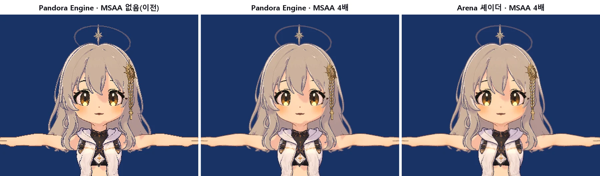

한 픽셀을 표본 네 개로 그린 뒤(`SceneTarget`) 선형 색으로 평균해 백 버퍼로 옮깁니다. 1픽셀 남짓한 외곽선에 보이던 계단이 사라집니다.

### Pandora Arena와 나란히 놓고 비교

<table>
<tr>
<td width="50%">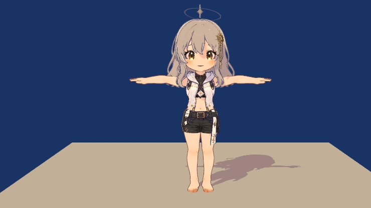<br><sub>Pandora Engine (DirectX 12)</sub></td>
<td width="50%"><br><sub>Pandora Arena 셰이더 (Unity URP)</sub></td>
</tr>
</table>

같은 Luna를 같은 카메라와 빛으로 두 엔진에서 그려 픽셀 단위로 비교합니다. 이 장면의 색 차이는 중앙값 4, 평균 4.9이고, 세 장면에서는 중앙값 1\~4, 평균 4.2\~5.6입니다(0\~255, 둘 다 MSAA 4배). 남은 차이는 대부분 윤곽, 밉맵이 없는 무늬, 한 가지 색으로 넣은 주변광에서 납니다.

### 그림체를 파일로 옮기기

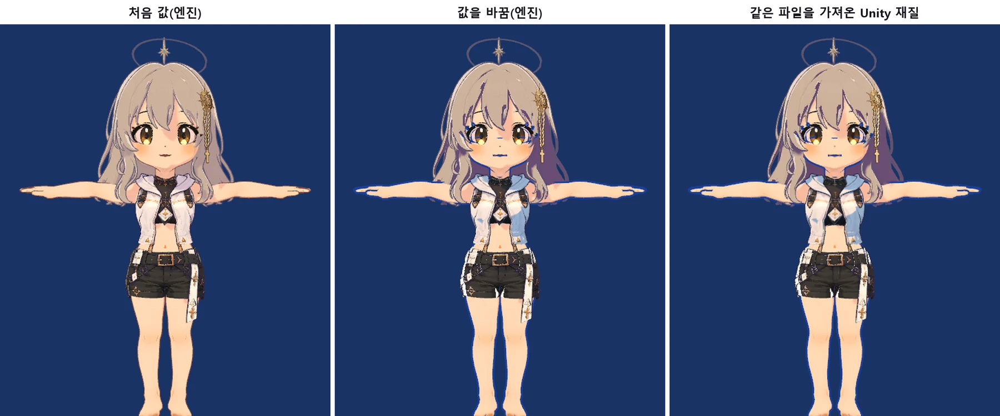

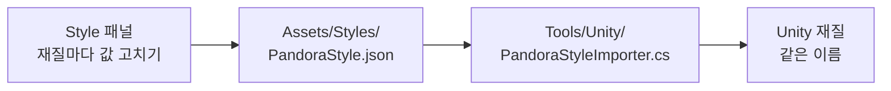

Style 패널에서 그늘색, 경계, 림라이트, 외곽선 값을 고치면 화면이 바로 바뀝니다. 저장하면 `PandoraStyle.json`에서 바꾼 줄만 달라지고, Unity 스크립트가 같은 이름의 재질에 그 값을 넣습니다. Pandora Arena 재질의 복사본으로 확인했고, 실제 게임에는 아직 넣지 않았습니다.

## 물음표에서 클래스 카드까지

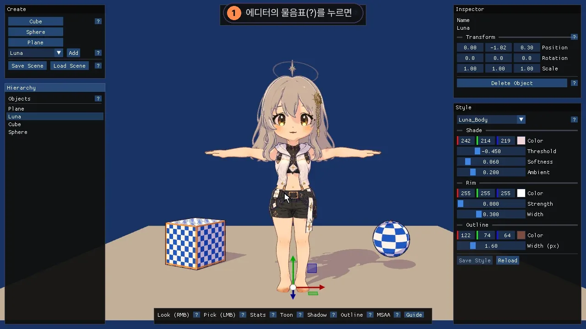

<sub>엔진을 실행해 찍은 화면 세 장을 이어 만든 움직이는 그림입니다.</sub>

에디터 곳곳의 `?`를 누르면 그 기능이 거쳐 가는 클래스를 순서대로 보여 주고, 클래스를 누르면 카드가 열립니다. 카드에는 그림과 하는 일, 없으면 생기는 문제, 지금의 한계, 언리얼에서 같은 역할을 하는 부분이 들어 있습니다.

<table>
<tr>
<td width="50%">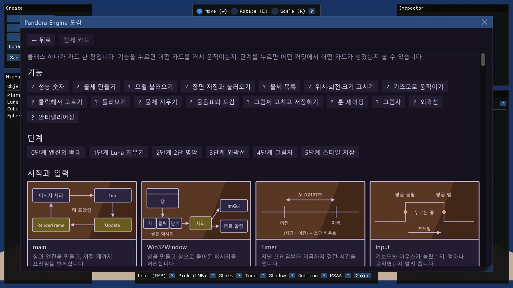<br><sub>첫 화면 · 기능과 단계, 클래스 카드</sub></td>
<td width="50%">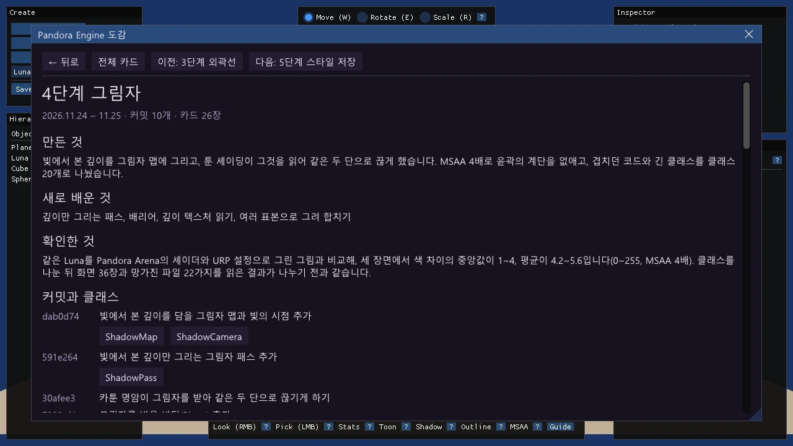<br><sub>단계 화면 · 만든 것과 확인한 것, 커밋과 그때 생긴 클래스</sub></td>
</tr>
</table>

내용은 모두 [`Assets/Guide/EngineGuide.json`](Assets/Guide/EngineGuide.json) 한 파일에 있습니다. `python Tools/Guide/check_guide.py`가 카드에 적은 파일 · 함수 · 클래스와 단계에 적은 커밋 번호 · 제목 · 날짜가 코드와 git 기록에 맞는지 검사합니다.

## 코드 구조

역할마다 `final` 클래스 하나를 두고, 클래스마다 도감 카드 한 장을 씁니다. C++ 파일은 저장소 맨 위 폴더에 있습니다.

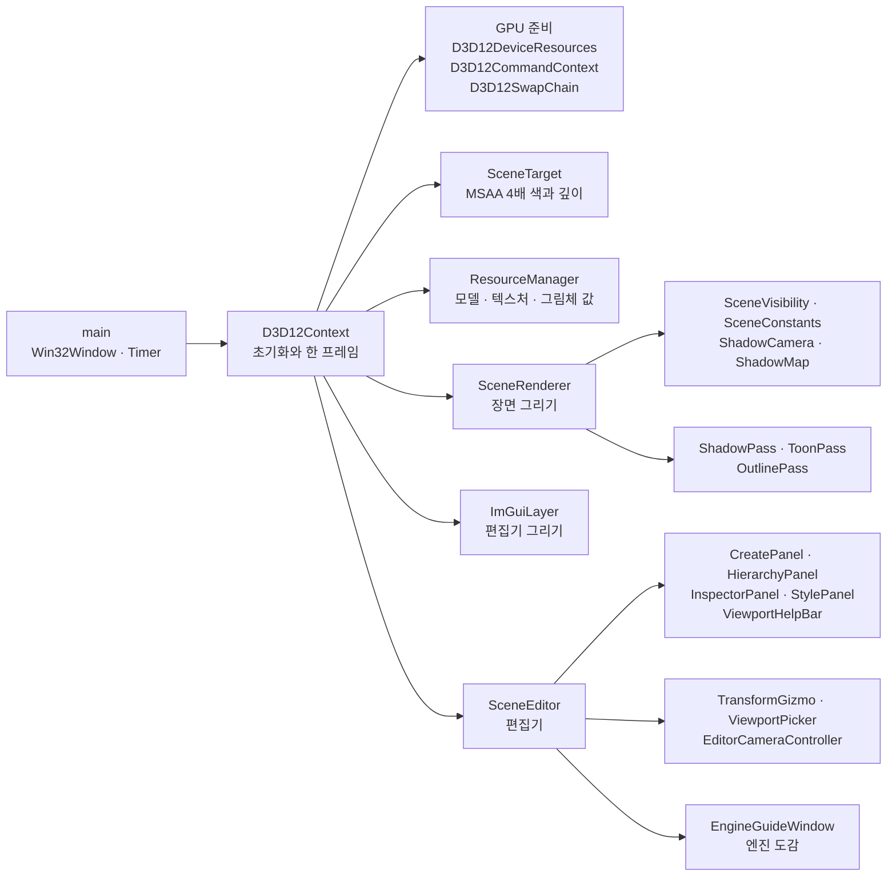

<details>
<summary>묶음 22개와 카드 95장 전체 보기</summary>

| 묶음 | 카드 |
|---|---|
| 시작과 입력 | `main` · `Win32Window` · `Timer` · `Input` |
| GPU 준비 | `D3D12DeviceResources` · `D3D12CommandContext` · `D3D12Fence` · `GpuBarrier` |
| 디스크립터 | `DescriptorHeap` · `TextureHeap` · `ImGuiDescriptorAllocator` |
| 화면과 깊이 | `D3D12SwapChain` · `SceneTarget` · `DepthBuffer` · `RenderArea` |
| 한 프레임 그리기 | `D3D12Context` · `SceneRenderer` · `SceneVisibility` · `SceneCuller` · `SceneConstants` · `RenderStatistics` |
| 그림자 | `ShadowPass` · `ShadowMap` · `ShadowCamera` · `ShadowSettings` |
| 그리기 패스 | `ToonPass` · `OutlinePass` · `OutlineNormalBaker` |
| 셰이더와 PSO | `Shader.hlsl` · `ShaderCompiler` · `D3D12RootSignature` · `D3D12Pipeline` · `VertexLayout` |
| GPU에 올리는 재료 | `Mesh` · `GpuBuffer` · `FrameConstantBuffer` · `Texture` · `GpuTexture` · `TextureUploader` |
| 모델 파일 읽기 | `ModelLoader` · `GltfModelReader` · `GltfPrimitiveReader` · `GltfFile` · `ImageLoader` |
| 모델 | `ResourceManager` · `Model` · `PrimitiveGeometry` |
| 카툰 재질과 빛 | `Material` · `MaterialStyleLibrary` · `SceneLighting` |
| 그림체 파일 | `MaterialStyleFileReader` · `MaterialStyleFileWriter` · `PandoraStyleImporter` |
| 장면 | `Scene` · `GameObject` · `Transform` |
| 장면 파일 | `SceneSerializer` · `SceneFileReader` · `SceneFileWriter` |
| 보는 눈과 판정 | `Camera` · `Frustum` · `Ray` · `AABB` |
| 편집기 뼈대 | `SceneEditor` · `EditorSelection` · `EditorLayout` · `ImGuiLayer` |
| 편집기 조작 | `EditorCameraController` · `TransformGizmo` · `ViewportPicker` |
| 편집기 패널 | `CreatePanel` · `HierarchyPanel` · `InspectorPanel` · `StylePanel` · `ViewportHelpBar` |
| 엔진 도감 | `EngineGuideWindow` · `EngineGuide` · `EngineGuideReader` · `GuideNavigation` · `GuideTheme` · `GuidePictureRenderer` |
| 도감 화면 | `GuideHelpButton` · `GuideNavigationBar` · `GuideHomePage` · `GuideCardPage` · `GuideFeaturePage` · `GuideStagePage` · `GuideCardGrid` · `GuideLinkButtons` |
| 값만 담는 파일 | `D3D12Config` · `RenderPassContext` · `ModelData` · `MaterialStyle` · `SceneData` · `EngineGuideData` |

</details>

클래스를 나눌 때마다 이전 빌드와 같은 순서로 실행해, 화면의 모든 픽셀과 저장한 파일이 같은지 비교했습니다.

## 빌드와 실행

1. Windows 10/11 x64와 DirectX 12를 지원하는 GPU, Visual Studio 2022(「C++를 사용한 데스크톱 개발」, v143 도구 집합, Windows SDK)가 필요합니다.
2. `DirectX12_Study.sln`을 열고 `x64`의 `Debug` 또는 `Release`로 빌드한 뒤 실행합니다. 프로젝트 이름(DirectX12_Study)은 공부용으로 시작할 때의 이름입니다.
3. 엔진은 `Shader.hlsl`과 `Assets/`를 현재 폴더에서 읽습니다. Visual Studio에서 실행하면 프로젝트 폴더가 현재 폴더가 됩니다. exe를 직접 실행할 때는 저장소 맨 위 폴더에서 실행합니다.
4. 처음에는 빈 장면입니다. 왼쪽 Create 패널에서 Cube, Sphere, Plane을 만들거나, `Assets/Models` 아래의 glTF(예: TestCube)를 골라 Add로 놓습니다. Save Scene과 Load Scene은 `Scenes/Scene.json`을 씁니다.

Luna 모델은 저장소에 넣지 않았습니다(`.gitignore`). 원본 블렌드 파일이 있을 때 [`Tools/Blender/export_luna.py`](Tools/Blender/export_luna.py)로 `Assets/Models/Luna`에 T자세 glTF를 내보냅니다.

## 조작

| 입력 | 동작 |
|---|---|
| 오른쪽 버튼을 누른 채 마우스 이동 | 둘러보기 |
| 오른쪽 버튼을 누른 채 `W` `A` `S` `D` | 앞뒤와 옆으로 이동 |
| 왼쪽 클릭 | 물체 고르기(빈 곳을 누르면 선택 해제) |
| `W` / `E` / `R` | 기즈모를 이동 / 회전 / 크기로 바꾸기 |
| `Delete` | 고른 물체 지우기 |
| `?` 버튼 | 그 기능의 도감 페이지 열기 |
| 아래 막대의 `Guide` | 도감 첫 화면 열기 |
| `Esc` | 도감 닫기 |

## 폴더

```text
Assets/Guide/EngineGuide.json        도감의 카드, 기능, 단계
Assets/Styles/PandoraStyle.json      재질마다 그림체 값
Assets/Models/TestCube/              시험용 glTF
Shader.hlsl                          화면, 외곽선, 그림자 셰이더
Tools/Blender/                       Luna 내보내기, 관문 1 비교 렌더, 시험 큐브 만들기
Tools/Guide/check_guide.py           도감이 코드와 git 기록에 맞는지 검사
Tools/Unity/PandoraStyleImporter.cs  그림체 파일을 Unity 재질에 넣기
ThirdParty/                          Dear ImGui, ImGuizmo, nlohmann/json
Docs/Readme/                         이 문서의 그림
```

## 다음 단계

6단계 뼈 애니메이션 → 7단계 표정 → 8단계 방 하나 → 9단계 대화 장면 순서로 이어 갑니다. 단계마다 Pandora Arena의 화면과 나란히 놓고 확인한 뒤 다음으로 넘어갑니다.

## 외부 라이브러리와 자료

| 이름 | 쓰는 곳 | 라이선스 |
|---|---|---|
| [Dear ImGui](https://github.com/ocornut/imgui) | 에디터와 도감 화면 | MIT · [`ThirdParty/imgui/LICENSE.txt`](ThirdParty/imgui/LICENSE.txt) |
| [ImGuizmo](https://github.com/CedricGuillemet/ImGuizmo) | 이동 · 회전 · 크기 기즈모 | MIT · [`ThirdParty/imguizmo/LICENSE.txt`](ThirdParty/imguizmo/LICENSE.txt) |
| [nlohmann/json](https://github.com/nlohmann/json) | 장면, 도감, 그림체 파일 읽고 쓰기 | MIT · [`ThirdParty/json/LICENSE.txt`](ThirdParty/json/LICENSE.txt) |
| 인물 Luna | 화면의 캐릭터 | 모델 생성 Tripo AI, 뼈대 AccuRig. 저장소에는 넣지 않았습니다 |

엔진 화면은 1280×720으로 실행해 찍었습니다. Unity 화면은 Pandora Arena의 셰이더와 재질을 복사한 임시 프로젝트에서 그렸고, 2단 명암 그래프는 셰이더의 식을 계산해 그렸습니다.
